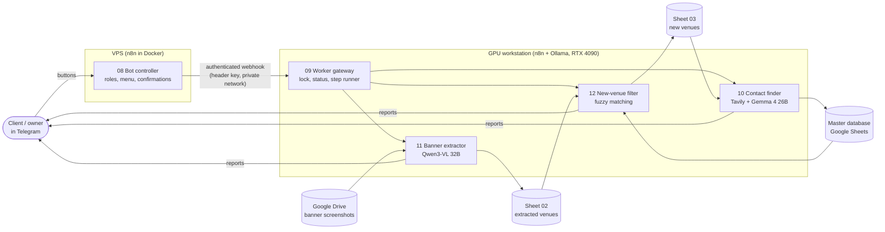

# Tour Venue Pipeline: n8n + local LLMs

A production n8n system for a small booking agency that organises European tours for rock bands. It turns screenshots of tour banners into a deduplicated list of new concert venues, finds booking contacts for each one and writes them into the agency's database. The client runs the whole thing from a Telegram bot.

**Result:** before the automation, the agency researched at most **~50 new venues a day** by hand. In the first three days after launch the pipeline added **1,500+ new venues** to their database. On the banners checked by hand, the vision model misread only one line, where another graphic element overlapped the text.

All LLM inference runs locally (Ollama on an RTX 4090), so client data never goes to an LLM provider and there are no per-token costs.

> The client is anonymised in this repository. Google Drive/Sheets IDs, credentials, chat IDs and hosts are replaced with placeholders such as `<SHEET_MASTER_DB_ID>` and `REPLACE_ME`. Telegram messages and code comments are in Russian, the client's language.

## Architecture

## The workflows

| File | Nodes | What it does |
|---|---|---|
| [`11_banner_venue_extractor`](workflows/11_banner_venue_extractor.json) | 32 | Reads every tour banner in a Drive folder with a vision model and appends country, city and venue rows to sheet 02. Processed banners move to `year/month/day` archive folders. |
| [`12_new_venue_filter`](workflows/12_new_venue_filter.json) | 20 | Checks sheet 02 against the client's master database. New venues go to sheet 03. Doubtful rows stay for a human, with the reason written into the sheet. |
| [`10_venue_contact_finder`](workflows/10_venue_contact_finder.json) | 54 | For each new venue, finds the official site, social pages and booking emails, writes a short description with genres and adds the row to the master database. |
| [`09_worker_gateway`](workflows/09_worker_gateway.json) | 22 | Webhook on the GPU machine. Handles `run` / `status` / `unlock`, holds a lock against parallel runs and runs 11 → 12 → 10 as sub-workflows, stopping on the first failure. |
| [`08_bot_controller`](workflows/08_bot_controller.json) | 17 | Telegram bot on the VPS: roles (owner / client), access requests approved by the owner, a menu with confirmation buttons, a dry-run option for the owner, status. |

### 11: banners → venues

- **Model choice was tested, not guessed.** On 10 real banners, `gemma4:26b` was fast but mixed up rows on tall Instagram screenshots. `qwen3-vl:32b` (thinking variant) was accurate but slow and returned empty output with a strict JSON schema. `qwen3-vl:32b-instruct` read images of any shape accurately in 15–35 s per banner, so it was chosen.
- Ollama's `format: schema` truncated this model's answers, so the prompt asks for compact JSON (one show = `[date, country, city, venue]`) and a Code node extracts and validates it.
- JavaScript post-processing maps country-code variants (`EN`, `SCO`, `GB` → `UK`; `SL` → `SI`), fixes ALL-CAPS names while keeping short acronyms (`RCA`, `ZDB`), drops `TBA`/`TBC` venues and removes duplicates within the run and against the sheet.
- A banner that fails to download or parse stays in the inbox and is listed in the Telegram report, so the next run retries it.

### 12: matching against the master database

- Venue names are compared by a normalised core: no diacritics, leading articles (`the`, `le`, `les`, `die`…), venue-type words (`club`, `bar`, `salle`…) or the city's own name. `Le Truskel` = `Truskel`, `Molotow Club` = `Molotow`.
- Cities match through an alias table (`Wien` = `Vienna`, `Gent` = `Ghent`, `Praha` = `Prague`…) and Levenshtein distance for typos.
- Uncertain cases are flagged, not guessed: same venue in another city, similar name in the same city, unknown country code, a city that exists only under another country, or a name that looks like a city (columns mixed up). A person writes `ok` in *Human Notes* to approve the row.
- Before writing, the workflow re-reads the sheet and writes nothing if someone edited the affected rows during the run.

### 10: contact enrichment

The search strategy was worked out offline first (Node.js research scripts against a cache of Tavily responses), then built into the workflow as a step loop: `Plan Step → search / fetch / extract → Plan Step …`.

- Short query `<NAME> <CITY>` with Tavily's `country` parameter; then the local LLM (Gemma 4 26B via n8n's LangChain nodes with a structured output parser) identifies the venue, picks the official site and corrects a misread name or city.
- Candidate sites are fetched directly (free). Tavily extract is used only when the page fails. A site is accepted only if it mentions the venue name and city.
- Escalation when no address is found: `"<NAME> <CITY> email"` → `advanced` search → search with the corrected name → Facebook / Instagram only.
- Emails are ranked: from the venue's own site, then addresses that match the venue name, then from its own social pages. Plugin, hosting and platform addresses are filtered out, and ROT13-obfuscated addresses are decoded.
- Every decision is written to a *Scraper Notes* column (`name corrected`, `site rejected`, `similar spelling accepted`…) so the client can see why a row looks the way it does.
- On the offline test set, rows with an email went from 0 to 16 out of 22 problem venues, at about 2.5 Tavily credits per venue. In the first live run, 46 of 71 venues got an email.
- Running out of credits, a rejected key or rate limiting stops the run cleanly. The row is marked and the next run continues from it.

## Reliability

- **Dry-run mode** in every workflow: real reads and real searches, no writes, a full report.
- **Human in the loop** for anything uncertain, through two sheet columns (*Automation Notes* / *Human Notes*) instead of a separate UI.
- **Idempotent runs:** processed rows get a final status and are skipped next time. Failed rows are retried.
- **Concurrency:** a lock row in an n8n Data Table (12-hour TTL) blocks parallel runs. Sheets are re-read before every write.
- **Error reporting:** each step reports to Telegram. A failed step stops the chain and names the error.
- **Security:** the worker webhook requires a header key and is reachable only over a private network. The bot checks the user's role, and new users need owner approval.

## Workflows as code

The workflows are written as code with the n8n Workflow SDK ([`src/`](src/)) and built into importable JSON with [`tools/build-workflow.js`](tools/build-workflow.js). That gives readable diffs, versioning and reuse of shared code (for example, the same normalisation functions in 11 and 12). The JSON in `workflows/` is exported from the running instances, so the SDK sources can be a revision behind.

## Running it yourself

1. Import the JSON files from [`workflows/`](workflows/) into n8n (Workflows → Import from file).
2. Create credentials: Google service account (Drive + Sheets), Telegram bot, Header Auth for the gateway, Header Auth for Tavily (`Authorization: Bearer …`).
3. Replace the `<…_ID>` placeholders and `REPLACE_ME` credential references, and update the sub-workflow IDs in the gateway's `Decide` node.
4. Pull the models: `ollama pull qwen3-vl:32b-instruct` and `ollama pull gemma4:26b` (24 GB of VRAM is enough for each).

## Author

Slava Zborovsky: n8n and AI automation, previously 25+ years in film VFX (pipelines, CG supervision). zborovsky@proton.me
